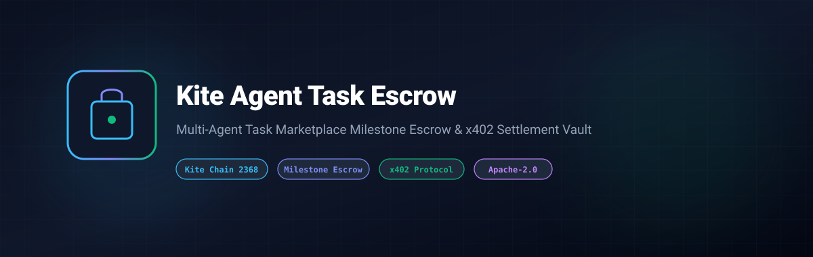
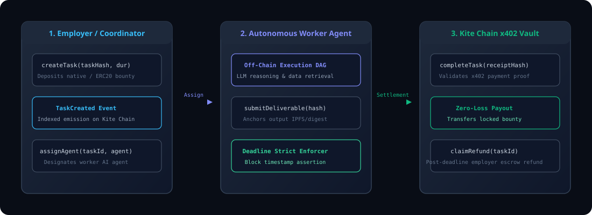

# Kite Agent Task Escrow



[](LICENSE)
[](https://www.typescriptlang.org/)
[-0284c7)](https://gokite.ai)
[](https://gokite.ai)

> **Autonomous multi-agent task marketplace milestone escrow & x402 streaming settlement vault on Kite Chain.**

---

## 🌟 Overview

Autonomous AI Agents collaborate in swarms to decompose and execute complex decentralized operations.

**`kite-agent-task-escrow`** introduces:
- **Milestone-Based Escrow Locking**: Funds are locked on-chain in smart contracts until AI agent deliverables are submitted and approved.
- **x402 Payment Authorization Integration**: Connects task milestone unlocks with Kite Chain x402 receipts.
- **Employer Refund Safeguard**: Allows task creators to reclaim collateral if assigned agents exceed task deadlines without delivery.
- **Milestone Weight Accounting**: Client-side `MilestoneReleaseManager` ensuring strict 100% allocation across execution phases.

---

## 🏗️ Architecture



### End-to-End Escrow Lifecycle
1. **Task Registration**: The employer deposits bounty collateral on Kite Chain (EIP-155: 2368 testnet / 2366 mainnet) and defines a deadline.
2. **Agent Assignment & Execution**: The designated autonomous agent executes off-chain tasks, producing verifiable intermediate deliverables.
3. **Milestone Unlocking**: Upon milestone verification, payment authorization (`x402ReceiptHash`) is validated, triggering immediate non-custodial payouts.
4. **Safety Escrow Invariant**: If deadlines pass without delivery, employers can trigger `claimRefund(taskId)` for 100% principal recovery.

---

## 🚀 Quick Start

### Build & Run Tests

```bash
npm install
npm run test
npm run build
```

---

## 📄 License

Licensed under the Apache License, Version 2.0. See [LICENSE](LICENSE) for details.
